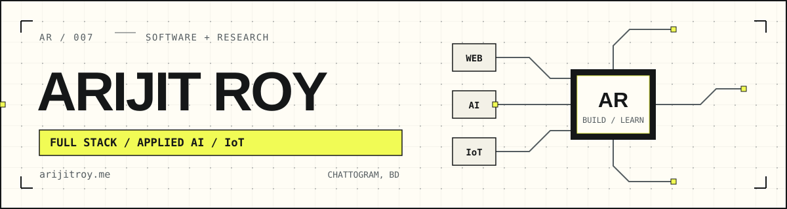
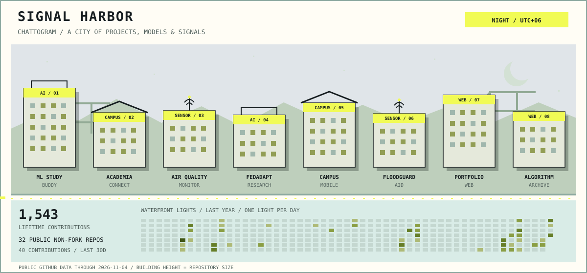
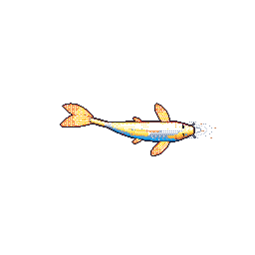
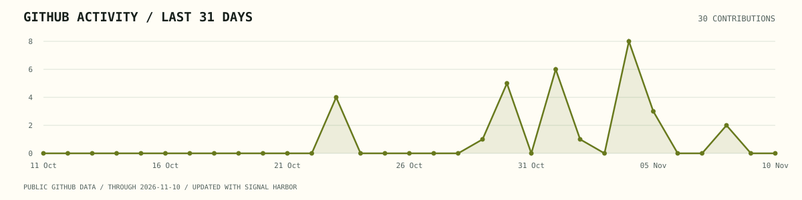

<picture>
  <source media="(prefers-color-scheme: dark)" srcset="assets/header-dark.svg">
  <source media="(prefers-color-scheme: light)" srcset="assets/header-light.svg">
  
</picture>

  <picture>
    <source media="(prefers-color-scheme: dark)" srcset="https://readme-typing-svg.demolab.com?font=Fira+Code&amp;weight=500&amp;size=24&amp;duration=2800&amp;pause=1800&amp;color=F1FB55&amp;center=true&amp;vCenter=true&amp;width=940&amp;height=56&amp;lines=Hey%2C+I%27m+Arijit.+Welcome+to+my+profile!;Full-stack+development+%C2%B7+Applied+AI+%C2%B7+IoT">
    
  </picture>
  

    
    &nbsp;
    
    &nbsp;
    
  

# Full-stack developer · Applied AI

I build web applications and AI tools, with projects in student learning, campus communities, and environmental monitoring. My research explores communication-efficient federated learning for medical imaging.

**[Portfolio](https://www.arijitroy.me/)** · **[LinkedIn](https://www.linkedin.com/in/arijit-roy-3004ar/)** · **[Email](mailto:contact@arijitroy.me)**

<!-- ## Featured work

| Project | What I built | Stack |
| :--- | :--- | :--- |
| **[ML Study Buddy](https://github.com/aroyy007/ML_Study_Buddy)** | A RAG study assistant with document retrieval, voice interaction, and domain-tuned embeddings. | Next.js · FastAPI · LangChain · FAISS |
| **[AcademiaConnect](https://github.com/aroyy007/AcademiaConnect)** | A university social platform with EDU-email registration, admin approval, student posts, and class routines. | React · TypeScript · Express · MongoDB |
| **[Air Quality Monitoring System](https://github.com/aroyy007/Air_Quality_Monitoring_System)** | An IoT monitoring system that connects gas sensors to an AQI dashboard, historical readings, and email alerts. | Arduino · Node.js · React · MongoDB |

[Explore my repositories →](https://github.com/aroyy007?tab=repositories) -->

## Languages, frameworks & tools

<table align="center">
  <tr>
    <td><strong>Languages</strong></td>
    <td><picture><source media="(prefers-color-scheme: dark)" srcset="https://skillicons.dev/icons?i=c,cpp,java,py,js,ts&amp;theme=dark"></picture></td>
  </tr>
  <tr>
    <td><strong>Frontend</strong></td>
    <td><picture><source media="(prefers-color-scheme: dark)" srcset="https://skillicons.dev/icons?i=html,css,react,nextjs,tailwind,redux&amp;theme=dark"></picture></td>
  </tr>
  <tr>
    <td><strong>Backend</strong></td>
    <td><picture><source media="(prefers-color-scheme: dark)" srcset="https://skillicons.dev/icons?i=nodejs,express,fastapi,django&amp;theme=dark"></picture></td>
  </tr>
  <tr>
    <td><strong>AI &amp; data</strong></td>
    <td><picture><source media="(prefers-color-scheme: dark)" srcset="https://skillicons.dev/icons?i=pytorch,tensorflow,sklearn,mongodb,mysql,firebase&amp;theme=dark"></picture></td>
  </tr>
  <tr>
    <td><strong>Tools &amp; creative</strong></td>
    <td><picture><source media="(prefers-color-scheme: dark)" srcset="https://skillicons.dev/icons?i=git,github,vscode,arduino,ps,pr&amp;theme=dark"></picture></td>
  </tr>
</table>

For retrieval and language-model applications, I also work with **Hugging Face, LangChain, and FAISS**.

## Signal Harbor

A small project city inspired by my home, Chattogram. The buildings represent my work in web development, AI, and IoT; the waterfront lights follow my contributions.

<picture>
  <source media="(prefers-color-scheme: dark)" srcset="assets/harbor/current-dark.svg">
  
</picture>

  <a href="views/dawn.md">Dawn</a> ·
  <a href="views/day.md">Day</a> ·
  <a href="views/dusk.md">Dusk</a> ·
  <a href="views/night.md">Night</a>
   
  The default sky follows Bangladesh time, refreshed every six hours.

  
How the harbor grows

  
Each building is one of my featured repositories, with height based on repository size. The waterfront is a calendar: one light per day, brighter when there are more contributions. The counters come from my public GitHub activity through the last complete UTC day.

  
Port cranes, hills, and sensor antennas connect the scene to Chattogram and my projects. This is original artwork and code, inspired by <a href="https://github.com/vineetjk/vineetjk">Vineet's Commit City</a>.

### The harbor koi

<table>
  <tr>
    <td align="center" width="280"></td>
    <td>
      <strong>A little life in the lab.</strong>
      
My languages color it, contributions grow it, and recent activity shapes how it swims.

      Generated from my account with <a href="https://github.com/yalongwastaken/git-koi">Git Koi</a>.
    </td>
  </tr>
</table>

## GitHub activity

<picture>
  <source media="(prefers-color-scheme: dark)" srcset="https://raw.githubusercontent.com/aroyy007/aroyy007/output/github-contribution-grid-snake-dark.svg">
  
</picture>

  
Activity graph · the last 31 days

   
  <picture>
    <source media="(prefers-color-scheme: dark)" srcset="assets/activity-dark.svg">
    
  </picture>

## Let's connect

I'm open to full-stack development and applied AI opportunities, freelance projects, and research collaboration.

Have something in mind? [Email me](mailto:contact@arijitroy.me) or [connect on LinkedIn](https://www.linkedin.com/in/arijit-roy-3004ar/).

  
  
  
  

Curious minds, thoughtful engineering, and good coffee are always welcome.

