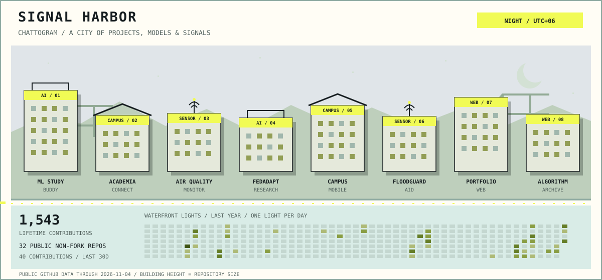

# Signal Harbor · Night

<picture>
  <source media="(prefers-color-scheme: dark)" srcset="../assets/harbor/night-dark.svg">
  
</picture>

[Dawn](dawn.md) · [Day](day.md) · [Dusk](dusk.md) · [Night](night.md) · [Back to my profile](../README.md#signal-harbor)

1,555 lifetime contributions · 32 public non-fork repositories · 37 contributions in the last 30 complete days.

The buildings represent my featured repositories. Their heights follow repository size in KB. The waterfront lights show daily contributions, through 2026-11-13.

Original artwork and generator for [Arijit Roy](https://github.com/aroyy007), inspired by [Vineet's Commit City](https://github.com/vineetjk/vineetjk).
